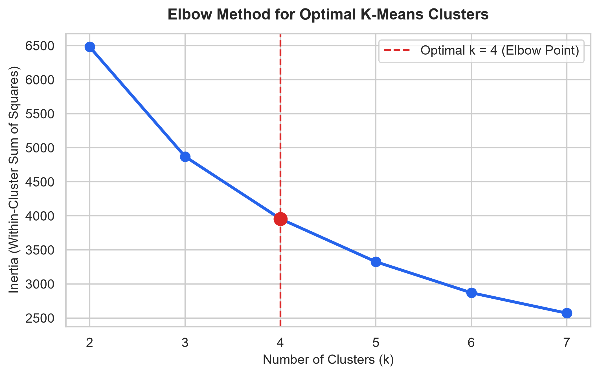
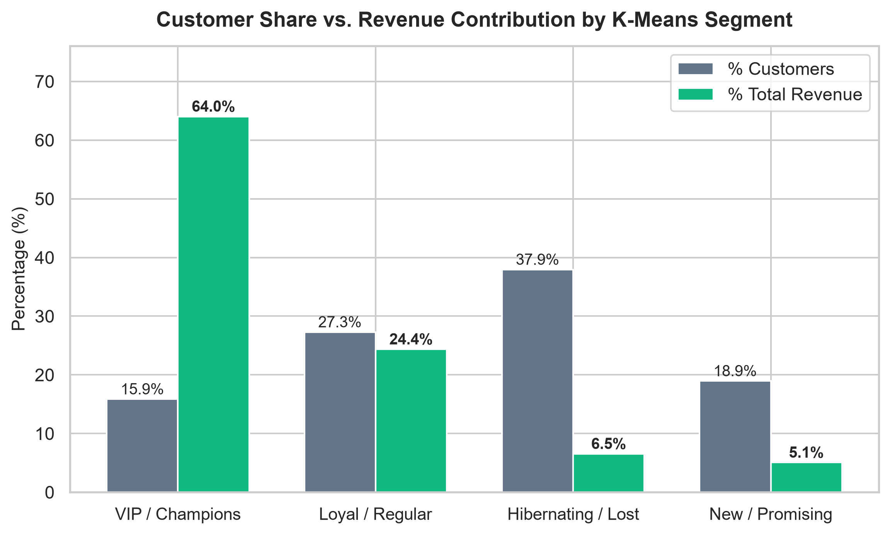
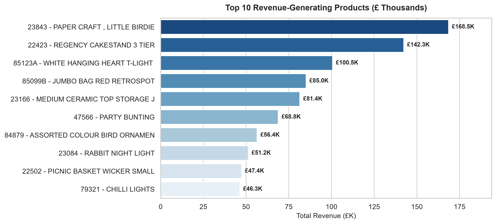

# End-to-End Retail Data Engineering & Analytics Pipeline

Xây dựng pipeline xử lý dữ liệu bán lẻ trực tuyến (541.910 bản ghi giao dịch) từ dữ liệu thô đến mô hình kho dữ liệu **Star Schema**, phân tích **RFM**, phân cụm khách hàng **K-Means** và hệ thống gợi ý sản phẩm mua kèm (**Item-based Collaborative Filtering**).

## 1. Kiến trúc luồng dữ liệu (Data Architecture)

```text
[online_retail_II.csv] (541,910 rows, ISO-8859-1)
         │
         ▼  (1. Ingestion & Data Quality Profiling)
[Data Cleaning & Validation] -> Loại bỏ trùng lặp, đơn hủy ('C'), khuyết ID, mã phi SP
         │
         ▼  (2. Star Schema Modeling - 391,150 clean rows)
┌────────────────────────────────────────────────────────┐
│              SQLite Data Warehouse (retail_dw.db)      │
│  • Core Tables: dim_customers, dim_products, fact_sales│
│  • Data Marts : mart_customer_rfm (SQL CTE & NTILE)    │
│                 mart_customer_clusters (K-Means k=4)   │
│                 mart_product_recommendations (Cosine)  │
└────────────────────────────────────────────────────────┘
```

## 2. Cấu trúc thư mục dự án

```text
retail-data-engineering-pipeline/
├── data/
│   ├── raw/                  # Chứa tệp dữ liệu gốc online_retail_II.csv (được loại trừ trên Git)
│   └── processed/            # Chứa kho dữ liệu SQLite retail_dw.db sinh ra sau khi chạy
├── sql/
│   └── rfm_analysis.sql      # Truy vấn SQL (CTE & Window Functions) tạo bảng tổng hợp RFM
├── src/
│   ├── ingestion_profiling.py # Đọc dữ liệu với schema định sẵn & kiểm định 7 lỗi chất lượng dữ liệu
│   ├── transform_load.py      # Làm sạch, tách bảng Star Schema, kiểm tra ràng buộc & tạo Index
│   ├── build_rfm_mart.py      # Thực thi kịch bản SQL tạo tầng Data Mart RFM
│   ├── clustering_rfm.py      # Tiền xử lý Log1p + StandardScaler & phân cụm K-Means gán nhãn động
│   └── recommender.py         # Tính ma trận Cosine Similarity & lưu trước gợi ý mua kèm
├── main.py                   # Điểm điều phối chạy toàn bộ pipeline từ Bước 1 đến Bước 5
├── requirements.txt          # Danh sách thư viện Python cần thiết
└── README.md
```

## 3. Kết quả chính đạt được

* **Data Quality & Warehousing:** Làm sạch **541.910** bản ghi thô, loại bỏ giao dịch trùng lặp, đơn hủy (`C`), bản ghi khuyết `Customer ID` và mã phi sản phẩm (`POST`, `DOT`, `BANK CHARGES`), giữ lại **391.150 giao dịch hợp lệ** (£8,74M doanh thu) cho **4.334 khách hàng** và **3.659 sản phẩm**.
* **Customer Segmentation (K-Means):** Chuẩn hóa đặc trưng RFM (`np.log1p` + `StandardScaler`), xác định 4 cụm hành vi khách hàng; nhóm **VIP / Champions** (687 khách hàng — 15,8%) đóng góp **64,0% tổng doanh thu** (£5,59M).
* **Product Recommendation:** Tính toán ma trận tương đồng Cosine trên **2.399 sản phẩm chủ lực** (có $\ge 20$ khách hàng mua), lưu trữ trước **11.995 đề xuất mua kèm** vào bảng `mart_product_recommendations` kèm đánh chỉ mục phục vụ truy vấn nhanh.

## 4. Trực quan hóa kết quả phân tích (Visual Insights)

### 4.1. Đánh giá số cụm tối ưu (Elbow Method) & Phân bổ doanh thu theo cụm K-Means
Nhóm **VIP / Champions** chỉ chiếm **15,8%** tổng lượng khách hàng nhưng đóng góp tới **64,0% tổng doanh thu** (£5,59M) — phản ánh rõ quy luật tập trung giá trị trong thương mại điện tử.

| Xác định số cụm tối ưu ($k = 4$) | Tỷ trọng Khách hàng vs. Doanh thu từng cụm |
| :---: | :---: |
|  |  |

### 4.2. Top 10 sản phẩm mang lại doanh thu cao nhất


## 5. Nguồn dữ liệu (Dataset)

* **Bộ dữ liệu:** Online Retail II (UCI Machine Learning Repository / Kaggle)
* **Quy mô:** 541.910 bản ghi giao dịch bán lẻ trực tuyến (giai đoạn 2010–2011) gồm 8 trường thông tin: `Invoice`, `StockCode`, `Description`, `Quantity`, `InvoiceDate`, `Price`, `Customer ID`, `Country`.
* **Cách chuẩn bị:** Tải tệp `online_retail_II.csv` từ [UCI Machine Learning Repository](https://archive.ics.uci.edu/dataset/502/online+retail+ii) và đặt vào đường dẫn `data/raw/online_retail_II.csv` trước khi chạy chương trình.

## 6. Hướng dẫn cài đặt và chạy dự án

```bash
# 1. Cài đặt các thư viện cần thiết
pip install -r requirements.txt

# 2. Chạy toàn bộ đường ống xử lý dữ liệu từ đầu đến cuối
python main.py
```